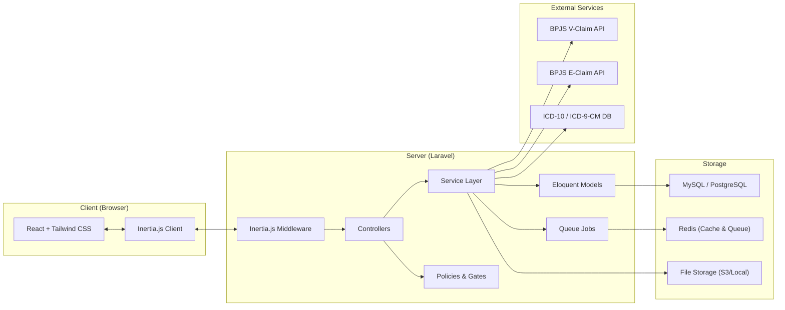
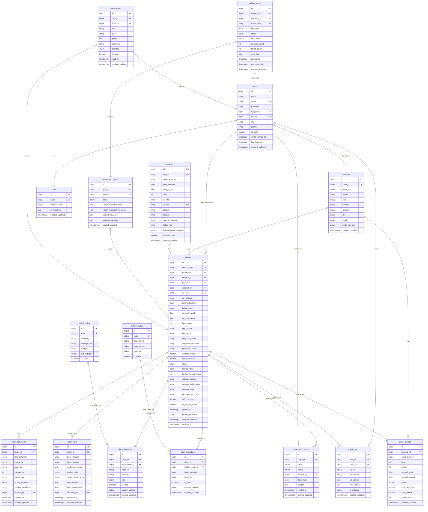
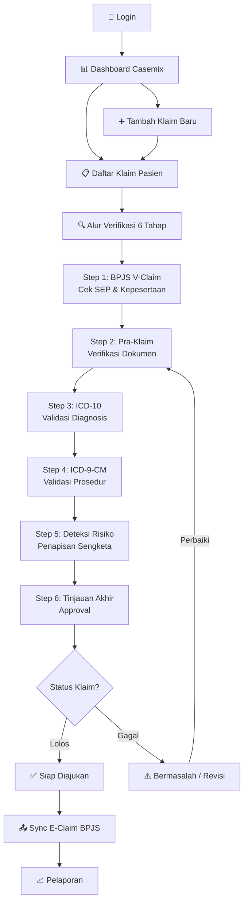

# 🏥 ClaimGuard — Rencana Implementasi Lengkap
## Sistem Manajemen Klaim BPJS & Casemix · Laravel + Inertia.js + React

> [!IMPORTANT]
> Dokumen ini mencakup: **Arsitektur Sistem**, **Struktur Database**, **Desain API/Routes**, **Komponen React**, dan **Tahapan Pengembangan** dari Login hingga Pelaporan & Sync E-Claim.

---

## 1. Arsitektur Sistem



### Tech Stack

| Layer | Teknologi |
|-------|-----------|
| Backend | Laravel 11+ (PHP 8.2+) |
| Frontend Adapter | Inertia.js v2 |
| Frontend Framework | React 19 + TypeScript |
| Styling | Tailwind CSS 4 |
| Charts | Recharts / Chart.js |
| State Management | Inertia Forms + React hooks |
| Database | MySQL 8 / PostgreSQL 16 |
| Cache & Queue | Redis |
| File Storage | Laravel Storage (local/S3) |
| Auth | Laravel Breeze (Inertia/React) |
| Testing | Pest (Backend), Vitest (Frontend) |

---

## 2. Struktur Database (ERD)



### Enum Values Reference

| Field | Values |
|-------|--------|
| `claims.status` | `baru`, `menunggu_verifikasi`, `bermasalah`, `siap_diajukan`, `diajukan`, `disetujui`, `ditolak` |
| `claims.jenis_pelayanan` | `rawat_inap`, `rawat_jalan` |
| `claims.tingkat_risiko` | `rendah`, `sedang`, `tinggi` |
| `claim_documents.tipe_dokumen` | `sep`, `rujukan`, `resume_medis`, `rincian_biaya`, `penunjang` |
| `claim_documents.status_verifikasi` | `belum_diperiksa`, `lengkap`, `tidak_lengkap`, `revisi` |
| `claim_verifications.tahap` | `vclaim`, `pra_klaim`, `icd10`, `icd9cm`, `risiko`, `tinjauan_akhir` |
| `claim_verifications.status` | `belum`, `lolos`, `gagal`, `perlu_revisi` |
| `claim_risks.tingkat_risiko` | `rendah`, `sedang`, `tinggi`, `kritis` |
| `claim_risks.status_tindak_lanjut` | `baru`, `dalam_proses`, `terselesaikan`, `diterima_risiko` |
| `claim_periods.status` | `aktif`, `ditutup`, `diarsipkan` |
| `eclaim_syncs.status` | `pending`, `processing`, `completed`, `failed` |
| `notifications.prioritas` | `rendah`, `normal`, `tinggi`, `urgent` |

---

## 3. Struktur Laravel Routes & Controllers

### Routes (`routes/web.php`)

```php
<?php

use Illuminate\Support\Facades\Route;

// ─── Authentication (Laravel Breeze) ────────────────────────
Route::middleware('guest')->group(function () {
    Route::get('/login', [AuthController::class, 'create'])->name('login');
    Route::post('/login', [AuthController::class, 'store']);
});

Route::middleware(['auth', 'verified'])->group(function () {
    Route::post('/logout', [AuthController::class, 'destroy'])->name('logout');

    // ─── Dashboard ──────────────────────────────────────────
    Route::get('/', [DashboardController::class, 'index'])->name('dashboard');
    Route::get('/dashboard', [DashboardController::class, 'index']);
    Route::get('/dashboard/summary/download', [DashboardController::class, 'downloadSummary'])->name('dashboard.summary');

    // ─── Klaim Pasien (CRUD) ────────────────────────────────
    Route::resource('klaim', ClaimController::class);
    Route::get('/klaim-export', [ClaimController::class, 'export'])->name('klaim.export');

    // ─── Alur Verifikasi (Workflow per Klaim) ───────────────
    Route::prefix('klaim/{claim}/verifikasi')->name('klaim.verifikasi.')->group(function () {
        Route::get('/vclaim', [VerificationController::class, 'vclaim'])->name('vclaim');
        Route::post('/vclaim/check-sep', [VerificationController::class, 'checkSep'])->name('vclaim.check-sep');
        Route::post('/vclaim/save', [VerificationController::class, 'saveVclaim'])->name('vclaim.save');

        Route::get('/pra-klaim', [VerificationController::class, 'praKlaim'])->name('pra-klaim');
        Route::post('/pra-klaim/upload-doc', [VerificationController::class, 'uploadDocument'])->name('pra-klaim.upload');
        Route::post('/pra-klaim/save', [VerificationController::class, 'savePraKlaim'])->name('pra-klaim.save');

        Route::get('/icd10', [VerificationController::class, 'icd10'])->name('icd10');
        Route::post('/icd10/validate', [VerificationController::class, 'validateIcd10'])->name('icd10.validate');
        Route::post('/icd10/save', [VerificationController::class, 'saveIcd10'])->name('icd10.save');

        Route::get('/icd9cm', [VerificationController::class, 'icd9cm'])->name('icd9cm');
        Route::post('/icd9cm/validate', [VerificationController::class, 'validateIcd9cm'])->name('icd9cm.validate');
        Route::post('/icd9cm/save', [VerificationController::class, 'saveIcd9cm'])->name('icd9cm.save');

        Route::get('/risiko', [VerificationController::class, 'risiko'])->name('risiko');
        Route::post('/risiko/scan', [VerificationController::class, 'scanRisiko'])->name('risiko.scan');
        Route::post('/risiko/save', [VerificationController::class, 'saveRisiko'])->name('risiko.save');

        Route::get('/tinjauan-akhir', [VerificationController::class, 'tinjauanAkhir'])->name('tinjauan-akhir');
        Route::post('/tinjauan-akhir/approve', [VerificationController::class, 'approve'])->name('tinjauan-akhir.approve');
        Route::post('/tinjauan-akhir/reject', [VerificationController::class, 'reject'])->name('tinjauan-akhir.reject');
    });

    // ─── Referensi ICD ──────────────────────────────────────
    Route::get('/api/icd10/search', [IcdController::class, 'searchIcd10'])->name('icd10.search');
    Route::get('/api/icd9cm/search', [IcdController::class, 'searchIcd9cm'])->name('icd9cm.search');

    // ─── Pasien ─────────────────────────────────────────────
    Route::resource('pasien', PatientController::class);
    Route::get('/api/pasien/search', [PatientController::class, 'search'])->name('pasien.search');

    // ─── E-Claim Sync ───────────────────────────────────────
    Route::prefix('eclaim')->name('eclaim.')->group(function () {
        Route::get('/', [EclaimController::class, 'index'])->name('index');
        Route::post('/sync', [EclaimController::class, 'sync'])->name('sync');
        Route::get('/history', [EclaimController::class, 'history'])->name('history');
        Route::get('/sync/{sync}', [EclaimController::class, 'showSync'])->name('sync.show');
        Route::post('/sync/{sync}/retry', [EclaimController::class, 'retrySync'])->name('sync.retry');
    });

    // ─── Pelaporan ──────────────────────────────────────────
    Route::prefix('laporan')->name('laporan.')->group(function () {
        Route::get('/', [ReportController::class, 'index'])->name('index');
        Route::get('/klaim-periode', [ReportController::class, 'claimByPeriod'])->name('klaim-periode');
        Route::get('/klaim-diagnosa', [ReportController::class, 'claimByDiagnosis'])->name('klaim-diagnosa');
        Route::get('/klaim-status', [ReportController::class, 'claimByStatus'])->name('klaim-status');
        Route::get('/pendapatan', [ReportController::class, 'revenue'])->name('pendapatan');
        Route::get('/export/{type}', [ReportController::class, 'export'])->name('export');
    });

    // ─── Notifikasi ─────────────────────────────────────────
    Route::prefix('notifikasi')->name('notifikasi.')->group(function () {
        Route::get('/', [NotificationController::class, 'index'])->name('index');
        Route::post('/mark-read', [NotificationController::class, 'markAllRead'])->name('mark-read');
        Route::post('/{notification}/read', [NotificationController::class, 'markAsRead'])->name('read');
    });

    // ─── Pengaturan ─────────────────────────────────────────
    Route::prefix('pengaturan')->name('pengaturan.')->group(function () {
        Route::get('/profil', [SettingsController::class, 'profile'])->name('profil');
        Route::put('/profil', [SettingsController::class, 'updateProfile']);
        Route::get('/rumah-sakit', [SettingsController::class, 'hospital'])->name('rumah-sakit');
        Route::put('/rumah-sakit', [SettingsController::class, 'updateHospital']);
        Route::get('/pengguna', [UserController::class, 'index'])->name('pengguna');
        Route::resource('pengguna', UserController::class)->except(['index']);
    });
});
```

---

## 4. Struktur Folder Laravel + React

```
claimguard/
├── app/
│   ├── Enums/
│   │   ├── ClaimStatus.php
│   │   ├── JenisPelayanan.php
│   │   ├── TingkatRisiko.php
│   │   ├── TipeDokumen.php
│   │   ├── TahapVerifikasi.php
│   │   └── StatusVerifikasi.php
│   ├── Http/
│   │   ├── Controllers/
│   │   │   ├── Auth/
│   │   │   │   └── AuthController.php
│   │   │   ├── DashboardController.php
│   │   │   ├── ClaimController.php
│   │   │   ├── VerificationController.php
│   │   │   ├── PatientController.php
│   │   │   ├── IcdController.php
│   │   │   ├── EclaimController.php
│   │   │   ├── ReportController.php
│   │   │   ├── NotificationController.php
│   │   │   ├── SettingsController.php
│   │   │   └── UserController.php
│   │   ├── Middleware/
│   │   │   ├── HandleInertiaRequests.php
│   │   │   └── EnsureHospitalContext.php
│   │   └── Requests/
│   │       ├── StoreClaimRequest.php
│   │       ├── UpdateClaimRequest.php
│   │       ├── UploadDocumentRequest.php
│   │       └── SyncEclaimRequest.php
│   ├── Models/
│   │   ├── User.php
│   │   ├── Role.php
│   │   ├── Hospital.php
│   │   ├── Patient.php
│   │   ├── Claim.php
│   │   ├── ClaimPeriod.php
│   │   ├── ClaimDocument.php
│   │   ├── ClaimVerification.php
│   │   ├── ClaimDiagnosis.php
│   │   ├── ClaimProcedure.php
│   │   ├── ClaimRisk.php
│   │   ├── Icd10Code.php
│   │   ├── Icd9cmCode.php
│   │   ├── EclaimSync.php
│   │   ├── EclaimSyncItem.php
│   │   ├── ActivityLog.php
│   │   └── Notification.php
│   ├── Policies/
│   │   ├── ClaimPolicy.php
│   │   ├── PatientPolicy.php
│   │   └── EclaimPolicy.php
│   ├── Services/
│   │   ├── BpjsVclaimService.php       # Integrasi V-Claim API
│   │   ├── BpjsEclaimService.php       # Integrasi E-Claim API
│   │   ├── ClaimVerificationService.php
│   │   ├── RiskDetectionService.php
│   │   ├── IcdValidationService.php
│   │   ├── ReportService.php
│   │   └── NotificationService.php
│   ├── Jobs/
│   │   ├── SyncEclaimBatch.php
│   │   ├── ProcessClaimVerification.php
│   │   └── GenerateMonthlyReport.php
│   ├── Events/
│   │   ├── ClaimStatusChanged.php
│   │   ├── ClaimVerified.php
│   │   └── EclaimSyncCompleted.php
│   └── Listeners/
│       ├── SendClaimStatusNotification.php
│       ├── LogClaimVerification.php
│       └── NotifyEclaimSyncResult.php
├── database/
│   ├── migrations/
│   │   ├── 0001_create_roles_table.php
│   │   ├── 0002_create_hospitals_table.php
│   │   ├── 0003_modify_users_table.php
│   │   ├── 0004_create_patients_table.php
│   │   ├── 0005_create_claim_periods_table.php
│   │   ├── 0006_create_claims_table.php
│   │   ├── 0007_create_claim_documents_table.php
│   │   ├── 0008_create_claim_verifications_table.php
│   │   ├── 0009_create_icd10_codes_table.php
│   │   ├── 0010_create_icd9cm_codes_table.php
│   │   ├── 0011_create_claim_diagnoses_table.php
│   │   ├── 0012_create_claim_procedures_table.php
│   │   ├── 0013_create_claim_risks_table.php
│   │   ├── 0014_create_eclaim_syncs_table.php
│   │   ├── 0015_create_eclaim_sync_items_table.php
│   │   ├── 0016_create_activity_logs_table.php
│   │   └── 0017_create_notifications_table.php
│   └── seeders/
│       ├── DatabaseSeeder.php
│       ├── RoleSeeder.php
│       ├── HospitalSeeder.php
│       ├── UserSeeder.php
│       ├── Icd10Seeder.php
│       ├── Icd9cmSeeder.php
│       ├── PatientSeeder.php
│       ├── ClaimPeriodSeeder.php
│       └── ClaimDemoSeeder.php
├── resources/
│   └── js/
│       ├── app.tsx
│       ├── types/
│       │   ├── index.d.ts            # Global TypeScript types
│       │   ├── claim.ts
│       │   ├── patient.ts
│       │   ├── user.ts
│       │   └── verification.ts
│       ├── Layouts/
│       │   ├── AuthenticatedLayout.tsx  # Sidebar + Navbar
│       │   ├── GuestLayout.tsx          # Login/Register
│       │   └── Sidebar.tsx
│       ├── Components/
│       │   ├── ui/                     # Reusable base components
│       │   │   ├── Button.tsx
│       │   │   ├── Badge.tsx
│       │   │   ├── Card.tsx
│       │   │   ├── DataTable.tsx
│       │   │   ├── Modal.tsx
│       │   │   ├── Toast.tsx
│       │   │   ├── Pagination.tsx
│       │   │   ├── SearchInput.tsx
│       │   │   ├── Select.tsx
│       │   │   ├── Stepper.tsx
│       │   │   ├── ProgressBar.tsx
│       │   │   ├── StatusBadge.tsx
│       │   │   ├── MetricCard.tsx
│       │   │   ├── Timeline.tsx
│       │   │   └── FileUploader.tsx
│       │   ├── Dashboard/
│       │   │   ├── MetricCards.tsx
│       │   │   ├── RevenueChart.tsx
│       │   │   ├── ReadinessDistribution.tsx
│       │   │   ├── PriorityQueue.tsx
│       │   │   └── ActivityTimeline.tsx
│       │   ├── Claims/
│       │   │   ├── ClaimTable.tsx
│       │   │   ├── ClaimDetailDrawer.tsx
│       │   │   ├── ClaimFormModal.tsx
│       │   │   ├── ClaimFilterTabs.tsx
│       │   │   └── ClaimStatusBadge.tsx
│       │   ├── Verification/
│       │   │   ├── WorkflowStepper.tsx
│       │   │   ├── PatientInfoBanner.tsx
│       │   │   ├── VclaimPanel.tsx
│       │   │   ├── PraKlaimPanel.tsx
│       │   │   ├── Icd10Panel.tsx
│       │   │   ├── Icd9cmPanel.tsx
│       │   │   ├── RiskDetectionPanel.tsx
│       │   │   ├── FinalReviewPanel.tsx
│       │   │   └── DocumentPreviewModal.tsx
│       │   ├── Eclaim/
│       │   │   ├── SyncDashboard.tsx
│       │   │   ├── SyncHistoryTable.tsx
│       │   │   └── SyncDetailModal.tsx
│       │   ├── Reports/
│       │   │   ├── ReportFilters.tsx
│       │   │   ├── ClaimPeriodChart.tsx
│       │   │   ├── DiagnosisDistribution.tsx
│       │   │   └── RevenueReport.tsx
│       │   └── Notifications/
│       │       ├── NotificationDropdown.tsx
│       │       └── NotificationList.tsx
│       └── Pages/
│           ├── Auth/
│           │   ├── Login.tsx
│           │   └── ForgotPassword.tsx
│           ├── Dashboard.tsx
│           ├── Claims/
│           │   ├── Index.tsx           # Klaim Pasien (list)
│           │   ├── Create.tsx          # + Tambah Klaim
│           │   ├── Show.tsx            # Detail Klaim
│           │   └── Edit.tsx
│           ├── Verification/
│           │   ├── Vclaim.tsx          # Step 1
│           │   ├── PraKlaim.tsx        # Step 2
│           │   ├── Icd10.tsx           # Step 3
│           │   ├── Icd9cm.tsx          # Step 4
│           │   ├── RiskDetection.tsx   # Step 5
│           │   └── FinalReview.tsx     # Step 6
│           ├── Eclaim/
│           │   ├── Index.tsx           # E-Claim Dashboard
│           │   └── History.tsx         # Riwayat Sync
│           ├── Reports/
│           │   ├── Index.tsx           # Laporan Overview
│           │   ├── ClaimByPeriod.tsx
│           │   ├── ClaimByDiagnosis.tsx
│           │   └── Revenue.tsx
│           ├── Patients/
│           │   ├── Index.tsx
│           │   └── Show.tsx
│           └── Settings/
│               ├── Profile.tsx
│               ├── Hospital.tsx
│               └── Users.tsx
```

---

## 5. Alur Proses Bisnis (Business Flow)



---

## 6. Service Layer — Integrasi BPJS

### 6.1 V-Claim Service

```php
// app/Services/BpjsVclaimService.php
class BpjsVclaimService
{
    // Config: cons_id, secret_key, base_url, user_key
    
    public function searchSep(string $noSep): array;
    public function getParticipantByCard(string $noKartu): array;
    public function getParticipantByNik(string $nik): array;
    public function getReferralByNumber(string $noRujukan): array;
    public function checkEligibility(string $noKartu, string $tanggalPelayanan): array;
    
    // Internal helpers
    private function createSignature(): string;    // HMAC-SHA256
    private function decrypt(string $response): array;  // LZString + AES-256-CBC
    private function request(string $endpoint, string $method = 'GET', array $data = []): array;
}
```

### 6.2 E-Claim Service

```php
// app/Services/BpjsEclaimService.php
class BpjsEclaimService
{
    public function sendClaimData(Claim $claim): array;
    public function getGrouper(Claim $claim): array;      // INA-CBGs grouper
    public function updateClaim(Claim $claim): array;
    public function deleteClaim(string $noSep): array;
    public function getClaimStatus(string $noSep): array;
    public function pullPulangData(string $tglPulang): array;

    // Batch operations
    public function syncBatch(EclaimSync $sync): void;
    public function retryFailedItems(EclaimSync $sync): void;
}
```

---

## 7. Tahapan Pengembangan (Sprint Plan)

### 🏁 Fase 0 — Setup Proyek (1 minggu)

| # | Task | Detail |
|---|------|--------|
| 0.1 | Init proyek Laravel | `laravel new claimguard`, install Breeze (Inertia/React/TS) |
| 0.2 | Setup Tailwind | Konfigurasi `tailwind.config.ts` dengan color palette dari mockup (`brand`, `sidebar`) |
| 0.3 | Setup database | MySQL/PostgreSQL, buat `.env` |
| 0.4 | Buat semua migration | 17 migration files sesuai ERD |
| 0.5 | Buat semua Model + Relationship | Eloquent models dengan `fillable`, `casts`, dan relations |
| 0.6 | Buat Enum classes | 10+ PHP Enum untuk status, tipe, dsb. |
| 0.7 | Buat Seeders | Roles, Hospital, demo Users, ICD-10/9 data, demo Claims |
| 0.8 | Setup base UI components | `Button`, `Card`, `Badge`, `Modal`, `Toast`, `SearchInput` |

### 🔐 Fase 1 — Autentikasi & Layout (1 minggu)

| # | Task | Detail |
|---|------|--------|
| 1.1 | Halaman Login | Form login dengan branding ClaimGuard (warna teal, logo shield) |
| 1.2 | `AuthenticatedLayout` | Sidebar navigation persis mockup + Top navbar + Breadcrumb |
| 1.3 | `Sidebar.tsx` | Hospital context card, navigation menu (Ruang Kerja, Tahapan Verifikasi), user footer |
| 1.4 | Middleware `HandleInertiaRequests` | Share auth user, hospital, unread notifications count, current period |
| 1.5 | Role & Permission | Gate/Policy untuk admin, petugas_casemix, verifikator, viewer |
| 1.6 | `NotificationDropdown` | Dropdown notifikasi di navbar persis mockup |

### 📊 Fase 2 — Dashboard (1 minggu)

| # | Task | Detail |
|---|------|--------|
| 2.1 | `DashboardController` | Aggregate queries: total, menunggu, bermasalah, siap diajukan |
| 2.2 | `Dashboard.tsx` page | Compose 5 widget areas |
| 2.3 | `MetricCards` | 4 metric cards (Total, Menunggu, Bermasalah, Siap) |
| 2.4 | `RevenueChart` | Bar chart 6 bulan (Nilai Klaim vs Dibayar) dengan Recharts |
| 2.5 | `ReadinessDistribution` | Progress bar multi-segmen + breakdown list |
| 2.6 | `PriorityQueue` | Tabel antrean prioritas klaim bermasalah |
| 2.7 | `ActivityTimeline` | Timeline aktivitas terbaru tim casemix |

### 📋 Fase 3 — Manajemen Klaim (2 minggu)

| # | Task | Detail |
|---|------|--------|
| 3.1 | `ClaimController` (index) | Paginated list, filter by status, search, period filter |
| 3.2 | `Claims/Index.tsx` | Filter tabs + Search + Table + Detail drawer |
| 3.3 | `ClaimTable` | Sortable table: Pasien, SEP, Tgl Masuk, Diagnosis, Status, Aksi |
| 3.4 | `ClaimDetailDrawer` | Panel kanan: info pasien, meta, alert, ubah status |
| 3.5 | `ClaimFormModal` (Create) | Modal 4 seksi: Identitas, Pelayanan, Koding, Status |
| 3.6 | `ClaimFormModal` (Edit) | Pre-fill data, opsi hapus klaim |
| 3.7 | `StoreClaimRequest` | Validation rules: nama, rm, sep, diagnosis, biaya |
| 3.8 | CRUD Backend | store, update, destroy + activity logging |
| 3.9 | Pagination & Filter | Server-side pagination, filter tab counts, full-text search |
| 3.10 | Export CSV/Excel | Download klaim data menggunakan Laravel Excel |

### 🔍 Fase 4 — Alur Verifikasi 6 Tahap (3 minggu)

| # | Task | Detail |
|---|------|--------|
| **Step 1: V-Claim** | | |
| 4.1 | `VerificationController::vclaim()` | Load claim + SEP data |
| 4.2 | `Vclaim.tsx` page | Search SEP, Hasil Penelusuran, Verifikasi Kepesertaan |
| 4.3 | `BpjsVclaimService` integration | API call ke V-Claim BPJS (atau mock data untuk dev) |
| **Step 2: Pra-Klaim** | | |
| 4.4 | `PraKlaim.tsx` page | Tabel dokumen 5 berkas wajib, progress bar, upload revisi |
| 4.5 | File upload handler | Store PDF/images, verify, update `claim_documents` |
| 4.6 | `DocumentPreviewModal` | Preview berkas dokumen medis |
| **Step 3: ICD-10** | | |
| 4.7 | `Icd10.tsx` page | Validasi diagnosis primer & sekunder, autocomplete ICD-10 |
| 4.8 | `IcdValidationService` | Cross-check kode ICD-10 terhadap resume medis |
| **Step 4: ICD-9-CM** | | |
| 4.9 | `Icd9cm.tsx` page | Validasi prosedur medis, autocomplete ICD-9-CM |
| **Step 5: Risiko** | | |
| 4.10 | `RiskDetection.tsx` page | Daftar temuan risiko, tingkat risiko, tindak lanjut |
| 4.11 | `RiskDetectionService` | Auto-scan: resume unsigned, kode tidak match, dsb. |
| **Step 6: Tinjauan Akhir** | | |
| 4.12 | `FinalReview.tsx` page | Ringkasan semua tahap, audit trail, tombol approve/reject |
| 4.13 | Approval flow | Update claim status, trigger notifications |
| **Shared** | | |
| 4.14 | `WorkflowStepper` component | Interactive 6-step progress tabs |
| 4.15 | `PatientInfoBanner` component | Banner info pasien di atas setiap step |
| 4.16 | `ClaimVerification` model | Save verification results per step |

### 📤 Fase 5 — Integrasi E-Claim (2 minggu)

| # | Task | Detail |
|---|------|--------|
| 5.1 | `BpjsEclaimService` | Implementasi koneksi API E-Claim BPJS |
| 5.2 | `Eclaim/Index.tsx` | Dashboard sync: klaim siap kirim, statistik, tombol sync |
| 5.3 | Batch sync mechanism | Pilih klaim → Kirim batch → Track progress |
| 5.4 | `SyncEclaimBatch` job | Background job untuk kirim ke E-Claim |
| 5.5 | `SyncHistoryTable` | Riwayat batch sync dengan status per item |
| 5.6 | Retry mechanism | Retry klaim gagal dalam batch |
| 5.7 | Response handling | Parse INA-CBGs grouper result, update `tarif_ina_cbgs` |
| 5.8 | Error logging | Log error per item sync ke `eclaim_sync_items` |

### 📈 Fase 6 — Pelaporan (1–2 minggu)

| # | Task | Detail |
|---|------|--------|
| 6.1 | `ReportController` | Aggregate queries untuk berbagai tipe laporan |
| 6.2 | `Reports/Index.tsx` | Overview laporan: metrik, chart ringkasan |
| 6.3 | Laporan per Periode | Tabel & chart klaim per bulan/periode |
| 6.4 | Laporan per Diagnosa | Top 10 diagnosa, distribusi ICD-10 |
| 6.5 | Laporan Pendapatan | Revenue trend, klaim vs dibayar, selisih |
| 6.6 | Export laporan | PDF (DomPDF/Snappy) & Excel export |

### 🔧 Fase 7 — Notifikasi & Activity Log (1 minggu)

| # | Task | Detail |
|---|------|--------|
| 7.1 | Notification system | Real-time notifications (database + optional broadcast) |
| 7.2 | Activity logging | Auto-log setiap create, update, delete, verify claim |
| 7.3 | `NotificationDropdown` | Dropdown di navbar dengan filter (Semua/Perlu Tindakan) |
| 7.4 | Event listeners | `ClaimStatusChanged` → notify relevant users |

### 🛡️ Fase 8 — Polish & Production (1–2 minggu)

| # | Task | Detail |
|---|------|--------|
| 8.1 | Responsive design | Mobile-friendly sidebar collapse, table scroll |
| 8.2 | Dark mode support | Optional dark mode toggle |
| 8.3 | Error handling | Global error pages, form validation UX |
| 8.4 | Performance | Query optimization, eager loading, caching |
| 8.5 | Testing | Feature tests (Pest), component tests (Vitest) |
| 8.6 | Deployment | Docker config, CI/CD, environment vars |

---

## 8. Contoh Key Model — `Claim.php`

```php
<?php

namespace App\Models;

use App\Enums\ClaimStatus;
use App\Enums\JenisPelayanan;
use App\Enums\TingkatRisiko;
use Illuminate\Database\Eloquent\Model;
use Illuminate\Database\Eloquent\SoftDeletes;
use Illuminate\Database\Eloquent\Relations\{BelongsTo, HasMany};

class Claim extends Model
{
    use SoftDeletes;

    protected $fillable = [
        'nomor_klaim', 'patient_id', 'hospital_id', 'period_id', 'created_by',
        'no_sep', 'no_rujukan', 'jenis_pelayanan', 'kelas_rawat',
        'tanggal_masuk', 'tanggal_pulang', 'lama_rawat',
        'dpjp_nama', 'dpjp_kode',
        'diagnosa_primer', 'diagnosa_sekunder', 'prosedur_utama',
        'estimasi_biaya', 'biaya_disetujui',
        'status', 'tingkat_risiko', 'jumlah_temuan_risiko',
        'catatan_temuan', 'catatan_tindak_lanjut',
        'grouper_code', 'grouper_description', 'tarif_ina_cbgs',
        'is_synced_eclaim', 'synced_at', 'eclaim_response',
    ];

    protected $casts = [
        'status'            => ClaimStatus::class,
        'jenis_pelayanan'   => JenisPelayanan::class,
        'tingkat_risiko'    => TingkatRisiko::class,
        'tanggal_masuk'     => 'date',
        'tanggal_pulang'    => 'date',
        'estimasi_biaya'    => 'decimal:2',
        'biaya_disetujui'   => 'decimal:2',
        'tarif_ina_cbgs'    => 'decimal:2',
        'is_synced_eclaim'  => 'boolean',
        'synced_at'         => 'datetime',
    ];

    // ─── Relationships ──────────────────────────────
    public function patient(): BelongsTo { return $this->belongsTo(Patient::class); }
    public function hospital(): BelongsTo { return $this->belongsTo(Hospital::class); }
    public function period(): BelongsTo { return $this->belongsTo(ClaimPeriod::class, 'period_id'); }
    public function creator(): BelongsTo { return $this->belongsTo(User::class, 'created_by'); }
    public function documents(): HasMany { return $this->hasMany(ClaimDocument::class); }
    public function verifications(): HasMany { return $this->hasMany(ClaimVerification::class); }
    public function diagnoses(): HasMany { return $this->hasMany(ClaimDiagnosis::class); }
    public function procedures(): HasMany { return $this->hasMany(ClaimProcedure::class); }
    public function risks(): HasMany { return $this->hasMany(ClaimRisk::class); }
    public function activityLogs(): HasMany { return $this->hasMany(ActivityLog::class); }

    // ─── Computed ────────────────────────────────────
    public function getLamaRawatAttribute(): int
    {
        return $this->tanggal_masuk->diffInDays($this->tanggal_pulang);
    }

    public function getDocumentCompletenessAttribute(): array
    {
        $docs = $this->documents;
        $required = ['sep', 'rujukan', 'resume_medis', 'rincian_biaya', 'penunjang'];
        $completed = $docs->where('status_verifikasi', 'lengkap')->pluck('tipe_dokumen')->toArray();
        return [
            'total'     => count($required),
            'completed' => count(array_intersect($required, $completed)),
            'missing'   => array_diff($required, $completed),
        ];
    }

    public function getVerificationSummaryAttribute(): array
    {
        return $this->verifications
            ->groupBy('tahap')
            ->map(fn ($v) => $v->last()?->status)
            ->toArray();
    }

    // ─── Scopes ─────────────────────────────────────
    public function scopeByStatus($query, string $status) { return $query->where('status', $status); }
    public function scopeByPeriod($query, int $periodId) { return $query->where('period_id', $periodId); }
    public function scopeReadyToSubmit($query) { return $query->where('status', ClaimStatus::SiapDiajukan); }
    public function scopeProblematic($query) { return $query->where('status', ClaimStatus::Bermasalah); }
    public function scopeNotSynced($query) { return $query->where('is_synced_eclaim', false); }
    public function scopeSearch($query, string $search)
    {
        return $query->where(function ($q) use ($search) {
            $q->whereHas('patient', fn ($pq) => $pq->where('nama_lengkap', 'like', "%{$search}%")
                ->orWhere('no_rm', 'like', "%{$search}%"))
              ->orWhere('no_sep', 'like', "%{$search}%")
              ->orWhere('nomor_klaim', 'like', "%{$search}%");
        });
    }
}
```

---

## 9. Contoh React Page — `Dashboard.tsx`

```tsx
import AuthenticatedLayout from '@/Layouts/AuthenticatedLayout';
import { Head } from '@inertiajs/react';
import MetricCards from '@/Components/Dashboard/MetricCards';
import RevenueChart from '@/Components/Dashboard/RevenueChart';
import ReadinessDistribution from '@/Components/Dashboard/ReadinessDistribution';
import PriorityQueue from '@/Components/Dashboard/PriorityQueue';
import ActivityTimeline from '@/Components/Dashboard/ActivityTimeline';

interface DashboardProps {
    metrics: {
        totalKlaim: number;
        menungguVerifikasi: number;
        bermasalah: number;
        siapDiajukan: number;
        percentageChange: number;
    };
    revenueData: Array<{
        bulan: string;
        nilaiKlaim: number;
        dibayar: number;
    }>;
    priorityQueue: Array<ClaimSummary>;
    recentActivity: Array<ActivityItem>;
    currentPeriod: { bulan: string; tahun: number };
}

export default function Dashboard({
    metrics, revenueData, priorityQueue, recentActivity, currentPeriod
}: DashboardProps) {
    return (
        <AuthenticatedLayout>
            <Head title="Dashboard Casemix" />
            
            <div className="space-y-6">
                {/* Page Header */}
                <div className="flex flex-col md:flex-row md:items-center md:justify-between gap-4">
                    <div>
                        <div className="text-[11px] font-semibold text-teal-700 tracking-wider uppercase mb-1">
                            MANAJEMEN KLAIM BPJS
                        </div>
                        <h2 className="text-2xl font-bold text-slate-900 tracking-tight">
                            Dashboard casemix
                        </h2>
                        <p className="text-xs text-slate-500 mt-0.5">
                            Pantau kesiapan klaim dan potensi pendapatan rumah sakit.
                        </p>
                    </div>
                    <div className="flex items-center gap-2.5">
                        {/* Action buttons ... */}
                    </div>
                </div>

                {/* 4 Metric Cards */}
                <MetricCards metrics={metrics} />

                {/* Charts Row */}
                <div className="grid grid-cols-1 lg:grid-cols-3 gap-6">
                    <div className="lg:col-span-2">
                        <RevenueChart data={revenueData} />
                    </div>
                    <ReadinessDistribution metrics={metrics} />
                </div>

                {/* Bottom Row */}
                <div className="grid grid-cols-1 lg:grid-cols-3 gap-6">
                    <div className="lg:col-span-2">
                        <PriorityQueue items={priorityQueue} />
                    </div>
                    <ActivityTimeline items={recentActivity} />
                </div>
            </div>
        </AuthenticatedLayout>
    );
}
```

---

## 10. Estimasi Timeline Keseluruhan

| Fase | Deskripsi | Durasi | Kumulatif |
|------|-----------|--------|-----------|
| Fase 0 | Setup & Scaffolding | 1 minggu | 1 minggu |
| Fase 1 | Auth & Layout | 1 minggu | 2 minggu |
| Fase 2 | Dashboard | 1 minggu | 3 minggu |
| Fase 3 | Manajemen Klaim | 2 minggu | 5 minggu |
| Fase 4 | Alur Verifikasi | 3 minggu | 8 minggu |
| Fase 5 | E-Claim Sync | 2 minggu | 10 minggu |
| Fase 6 | Pelaporan | 1–2 minggu | 12 minggu |
| Fase 7 | Notifikasi & Log | 1 minggu | 13 minggu |
| Fase 8 | Polish & Deploy | 1–2 minggu | **~14–15 minggu** |

> [!TIP]
> Untuk 1 developer full-time, estimasi total sekitar **3,5–4 bulan**. Dengan tim 2–3 dev, bisa paralel Fase 3–4 dengan Fase 5–6, sehingga menjadi **~2–2,5 bulan**.

---

## 11. Langkah Pertama — Perintah Setup

```bash
# 1. Buat proyek Laravel baru
composer create-project laravel/laravel claimguard
cd claimguard

# 2. Install Breeze dengan Inertia + React + TypeScript
composer require laravel/breeze --dev
php artisan breeze:install react --typescript --ssr

# 3. Install dependensi tambahan
npm install recharts @headlessui/react @heroicons/react lucide-react
npm install -D @types/node

# 4. Install package Laravel
composer require maatwebsite/excel  # Export Excel
composer require barryvdh/laravel-dompdf  # PDF reports
composer require spatie/laravel-activitylog  # Activity logging

# 5. Konfigurasi database di .env, lalu:
php artisan migrate
php artisan db:seed

# 6. Jalankan
npm run dev
php artisan serve
```

---

> [!NOTE]
> Rencana ini disusun berdasarkan analisis lengkap mockup HTML/JS ClaimGuard yang mencakup 8 halaman utama (Dashboard, Klaim Pasien, dan 6 tahap verifikasi) beserta modal CRUD dan interaksi simulasi. Semua fitur mockup telah dipetakan ke arsitektur Laravel + Inertia.js + React yang production-ready.
